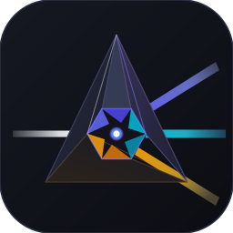
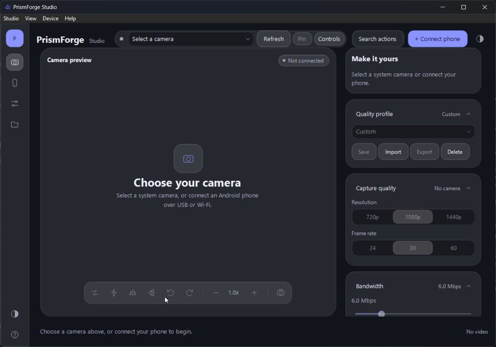
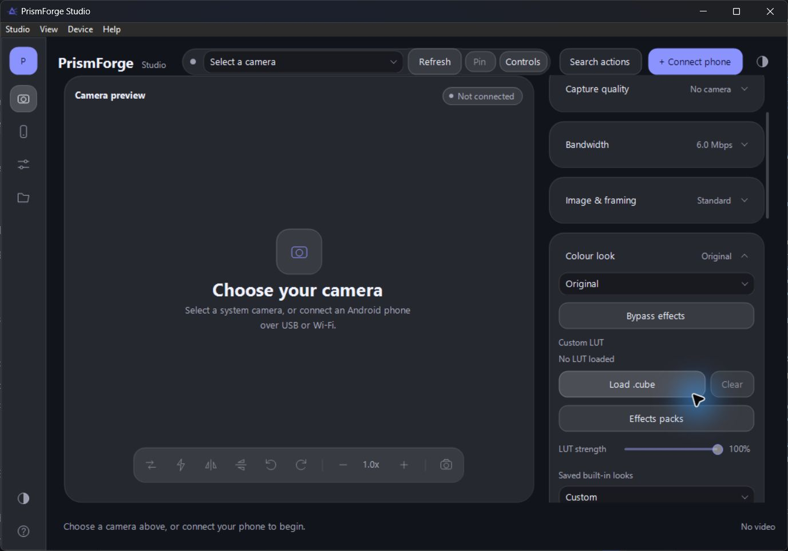
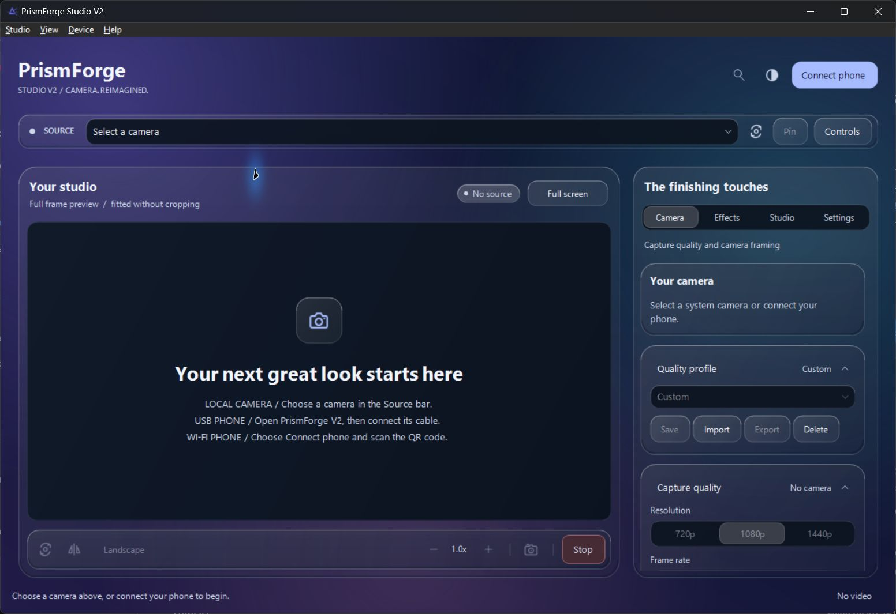
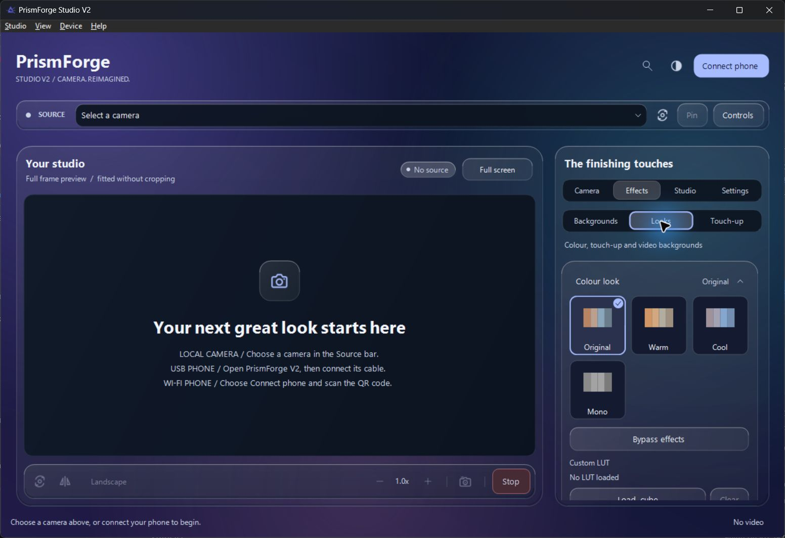
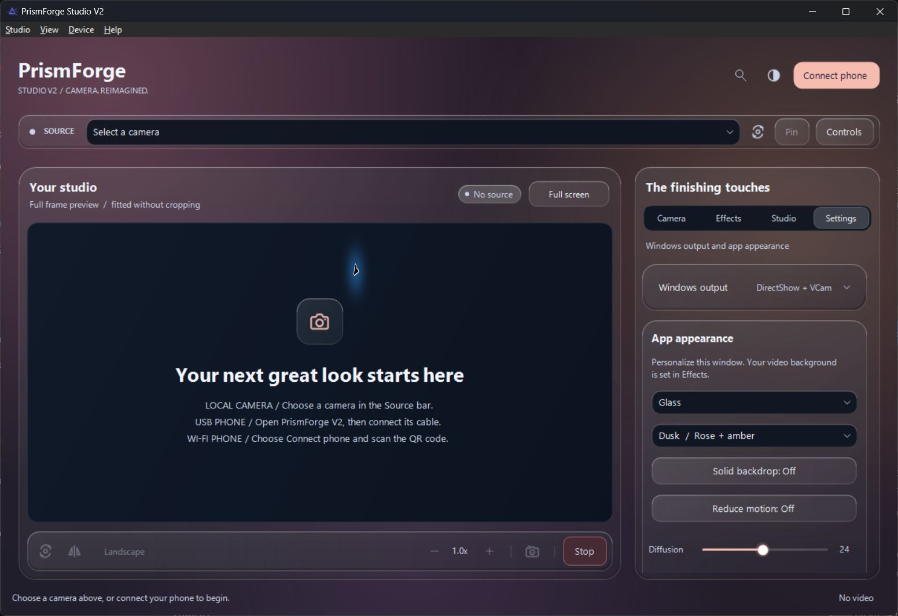

<h1 align="center">PrismForge Studio V1</h1>

<strong>Your phone camera. Your Windows studio.</strong> Connect, frame, light and create—over USB or Wi-Fi.

<a href="https://github.com/Kashyaplakkoju/PrismForge-V1/releases/latest">Download for Windows & Android</a> · <a href="docs/GETTING-STARTED.md">Setup guide</a> · <a href="docs/BUILD.md">Build from source</a> · <a href="https://github.com/Kashyaplakkoju/PrismForge-V1/issues">Feedback</a>

PrismForge turns an Android phone into a camera source for Windows. Its desktop
studio adds framing, colour, lighting and background tools before publishing
the result through a virtual camera that compatible meeting and recording apps
can select.

**V1 is available free for education, experimentation and feedback.** This
repository contains the Windows and Android projects, public assets and build
tools. Downloadable Windows and APK files are on the
[Releases page](https://github.com/Kashyaplakkoju/PrismForge-V1/releases).

## Inside the studio

*Actual V1 interface in its isolated preview mode. Camera and network services
are disabled for these screenshots.*

## What V1 can do

| Workflow | Included |
| --- | --- |
| Connect | Android camera over USB/ADB or Wi-Fi/RTSP; QR-assisted pairing |
| Choose a source | Phone streams and Windows-visible camera/capture devices |
| Frame | Rotation, mirroring, zoom and camera quality controls |
| Create a look | Colour adjustments, local `.cube` LUTs and offline colour packs |
| Light and finish | Studio lighting, face lighting, touch-up and background blur/replacement |
| Add accessories | Glasses, the attributed cap and three original native 3D starter filters |
| Explore your own models | Bounded static `.glb` import with fit and resource-budget controls |
| Send the result | Desktop preview and PrismForge virtual-camera output |

Capabilities depend on the selected source, phone and receiving app. Local
model import supports bounded static conversion; full animation and every glTF
material feature are outside V1's supported scope.

## Start in a few minutes

1. Download **Windows x64** and the **Android companion APK** from Releases.
2. Extract the Windows bundle to a permanent folder. Run `scripts/install.bat`
   as administrator once to register the PrismForge virtual camera.
3. Install the APK on your phone. Grant camera access. For USB, enable USB
   debugging and approve this computer on the phone.
4. Open `PrismForgeStudio.exe`, start the phone's USB or Wi-Fi connection and
   choose the source on Windows.
5. Select **PrismForge Studio** in your meeting or recording app's camera list.

See [the setup and troubleshooting guide](docs/GETTING-STARTED.md)
for Wi-Fi, updates and removal. Registration and removal are explicit actions;
merely downloading this repository performs neither.

## Releases and expectations

This is a **community development release**, supplied as-is. The Windows
executables are unsigned and the companion APK is debug-signed. There is no
guarantee of a particular FPS, device compatibility or latency. Windows and
Android may display installation warnings. Use SHA-256 checksums to verify
downloads; checksums establish file identity, not publisher trust.

The public build is based on the October 10 V1 source checkpoint. It excludes
private user model copies and the unused Standard-licensed visor. The local
Royal crown preset requires its own asset and is not supplied in this release;
you can use your own permitted models through the local-model importer.

PrismForge V2 is developed separately as the paid studio edition, with its
updated interface and presentation workflows. V2 code and packages are not
included in this repository.

## Project map

| Path | Contents |
| --- | --- |
| `windows/` | Native C++/wxWidgets studio, capture and virtual-camera components |
| `android/` | Kotlin Android companion |
| `assets/` | Original starter assets and colour-pack source materials |
| `tests/` | Focused native and Android test code |
| `scripts/`, `tools/` | Build, package and verification tools |
| `docs/` | Setup, build, privacy and release information |

## Credits and licenses

PrismForge builds on [VCamdroid](https://github.com/darusc/VCamdroid),
[Softcam](https://github.com/tshino/softcam), wxWidgets, FFmpeg,
Project Nayuki's QR Code generator, ONNX Runtime and MediaPipe. Their authors'
work and notices are preserved. This is an independently maintained fork.

The software code retains the [MIT license](LICENSE). Assets and dependencies
retain their individual terms; read [asset notices](ASSET-NOTICES.md) and the
notices supplied with the Windows download. MIT-licensed code does not impose
an educational-only restriction.

## Help shape the next iteration

If you try V1, [open an issue](https://github.com/Kashyaplakkoju/PrismForge-V1/issues)
with your Windows version, Android version, connection mode, selected source
and receiving app. Describe what you expected and what happened. Remove
personal images, device identifiers and private addresses from attachments.

---

## A look at PrismForge V2

**The next chapter: a studio for teaching, presenting and creating.** V2 is the
separate paid edition in development. It builds on V1's camera, colour, lighting
and accessory tools, with a redesigned workspace and new ways to present a
screen alongside your camera.

The free downloads above are **V1**. V2 source and binaries are not included in
this repository, and a paid Store release has not been published.

### A workspace that makes room for your work

The preview stays at the centre, with Camera, Effects, Studio and Settings in a
single inspector. Clearly labelled Landscape / Portrait controls are available
on Windows and Android; landscape is the default.

| V2 addition | What it enables |
| --- | --- |
| Windows screen and window sharing | Present a desktop or selected window, either on its own or behind a segmented camera presenter. Adjust presenter size and choose either bottom corner. |
| Android screen sharing | Share your phone screen, or add a rectangular camera tile. Android's consent prompt, visible status and Stop controls keep the session explicit. |
| Moving video backgrounds | Choose Aurora drift or Soft waves, or loop a local MP4, WebM, MOV or GIF. Pause and resume the background independently. |
| Visual effects galleries | Browse background, colour-look and accessory choices through thumbnails, with controls grouped by the task. |
| Personal glass themes | Choose Aurora, Dusk or Obsidian, tune the glass finish, or use System, Dark or Light. A reduced-motion option is included. |
| Clear framing and quality controls | Switch the outgoing Landscape / Portrait mode on either device. Fresh camera settings target 25 Mbps, with manual reduction available. Actual bitrate varies with content and connection. |

### Find a look, then fine-tune it

### Make the studio your own

*These are actual development screenshots of the native Windows V2 interface,
captured in isolated UI preview mode. They illustrate the interface rather
than a live processing result.*

Screen sharing and moving backgrounds currently carry **video only**. The
Android camera tile and the Windows segmented presenter are different modes.
Final distribution, Store certification and compatibility checks remain part
of V2's release work; no universal device, FPS or receiving-app guarantee is
implied by this preview.
